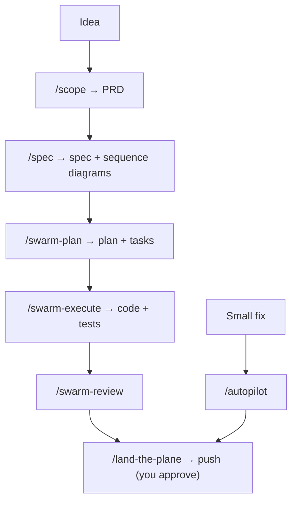

# How agentic-sdlc Works

agentic-sdlc gives Claude Code a delivery process: what to write before coding, who does each job, which checks must pass, and when a human decides. Everything lives as files in your repository, so it is versioned, reviewed and changed like code.

## The Pieces

| Piece | Where | Loaded |
|-------|-------|--------|
| Rules | `.claude/rules/*.md` | every session (about 14 KiB) |
| Worker agents | `.claude/agents/worker-*.md` | when a skill or the orchestrator starts one |
| Skills | `.claude/skills/*/SKILL.md` | when you type `/<skill>` or a workflow calls it |
| Hooks | `.claude/hooks/*.mjs`, wired in `.claude/settings.json` | on session start, before tool calls, on stop |
| Project commands | `sdlc.config.json` | read by scripts and skills at run time |
| Tech strategy | `.claude/rules/tech-strategy.md` | every session; confirmed by you with `/welcome` in the first session |
| Scripts | `scripts/sdlc/` | autopilot gates, QA twice, metrics, Evolve, cost |
| Templates | `templates/artifacts/` | when a PRD, ADR, spec or plan is written |

## The Flow



Ceremony scales with the change (`core-directives.md`): a typo needs nothing, a small fix at most a plan, a feature a PRD and sequence diagrams, a large bet a PR-FAQ first. A hard-to-reverse decision needs an ADR at any size.

## Who Does What

| Worker | Model | Job |
|--------|-------|-----|
| `worker-explorer` | Haiku | find code and facts, cheaply |
| `worker-builder` | Sonnet | implement one task with its tests |
| `worker-reviewer` | Sonnet | review a diff or plan; ends with a verdict block |
| `worker-research` | Sonnet | multi-source investigation, written up |
| `worker-architect` | Opus | hard-to-reverse decisions, as ADRs |

The session you talk to is the orchestrator: it starts workers, merges their results, edits tracking files and commits. Workers never start workers.

## Gates

- **Tests first** for logic; a failing regression test before every bug fix.
- **Gates** before each commit: the `gates` of every component the change touched (`sdlc.config.json`).
- **Review** before commit: `worker-reviewer` ends with `VERDICT: approve | revise` and counted `[B]` blocking and `[A]` advisory findings. Any `[B]` means another round.
- **QA twice**: changed tests run twice; a test that fails once is flaky, twice is a failure.
- **You approve every push.** The only exceptions are the autopilot opt-ins below, and even they re-check everything in code.

## Autopilot

`/autopilot <request>` runs one small change end to end:

```
Plan ⇄ Plan review → [Gate 1: you] → Implement ⇄ Code review → QA ×2 ⇄ Fix → Commit → [Gate 2: you] → CI + smoke
```

Each loop stops after three rounds. `--auto-push` lets Gate 2 push without asking when `scripts/sdlc/autopilot-autopush-check.sh` passes (nothing protected changed, under `maxLoc` changed lines, clean tree); `--auto` also skips Gate 1 when the plan review approved. With `--with autopilot` installed, the same flow runs on GitHub from an issue labelled `autopilot` (ADR-0002), with gates as PR comments and opt-in auto-merge labels (ADR-0003).

## Evolve

The agent improves its own rules from evidence:

1. `scripts/sdlc/agent-metrics.mjs` finds bad signals: a `fix:` commit that changed lines an autopilot run wrote, a revert, a closed `bug` issue whose fix changed agent-written lines (`git blame`), blocked or flaky runs.
2. `/evolve` traces each signal with Five Whys to the stage that should have caught it.
3. It proposes one added rule line and a seeded case in `evals/seeded/` (the real diff plus patterns of a correct finding).
4. `scripts/sdlc/evolve.mjs gate` runs the reviewer with the old and new rules: the proposal passes only if the old rules miss the case and the new ones catch it, without breaking other cases.
5. You merge or drop it.

The checks are code on your default branch, so a proposal cannot change how it is judged (ADR-0004, ADR-0006).

## Session File

`session.txt` holds the one task in flight (status, progress, done, doing, next). It is committed, so another machine sees where work stopped. The session-start hook shows it when Claude Code starts, and `/task-resume` continues it.

## What Is Enforced How

Prose rules can be ignored by a model that slips; hooks catch known patterns and ask or deny; `permissions.deny` and CI cannot be bypassed by the agent. `security.md` lists which level holds each rule. When something matters, move its check toward CI.
