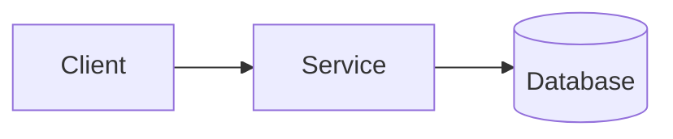

# System Design: <Component>

**Status:** Draft | Approved · **Date:** YYYY-MM-DD · **ADRs:** <list>

## Purpose and Scope

What the component does and does not do.

## Architecture

Each box: responsibility, technology, owner.

## Data Flow

Main request paths, with sequence diagrams in `docs/sequence/` when there is a PRD.

## Scaling and Limits

Expected load, bottlenecks, limits, caching.

## Failure Modes

What happens when each dependency is slow or down; timeouts, retries, fallbacks.

## Security

Trust boundaries, authentication, authorization, data classification.

## Operations

Deploy, configuration, monitoring, alerts, runbooks.
